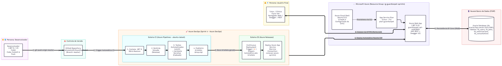

# GuardianPet API — Desafio Clyvo Vet

[](https://dotnet.microsoft.com/)
[](https://azure.microsoft.com/products/app-service/)
[](https://azure.microsoft.com/products/devops/)
[](https://www.oracle.com/database/)
[](https://xunit.net/)

Repositório da entrega da **Sprint 4** da disciplina **DevOps Tools & Cloud Computing**, ministrada pelo professor João Menk na FIAP. O projeto integra a API **GuardianPetV2**, desenvolvida em **ASP.NET Core 8.0**, ao **Oracle Database em nuvem** e a um fluxo automatizado de **CI/CD com Azure DevOps**, com publicação no **Azure App Service para Linux**.

---

## Índice

- [Visão geral](#visão-geral)
- [Objetivos e benefícios](#objetivos-e-benefícios)
- [Integrantes](#integrantes)
- [Tecnologias e serviços](#tecnologias-e-serviços)
- [Arquitetura da solução](#arquitetura-da-solução)
- [Fluxo de CI/CD](#fluxo-de-cicd)
- [Provisionamento da infraestrutura](#provisionamento-da-infraestrutura)
- [Configuração no Azure DevOps](#configuração-no-azure-devops)
- [Execução e validação da API](#execução-e-validação-da-api)
- [Validação da persistência no Oracle](#validação-da-persistência-no-oracle)
- [Links do projeto](#links-do-projeto)

---

## Visão geral

O **GuardianPet** é uma API RESTful criada para atender ao desafio proposto pela **Clyvo Vet**, com foco no acompanhamento contínuo, preventivo e integrado da saúde dos animais de estimação.

A solução centraliza o gerenciamento das seguintes entidades:

| Entidade | Tabela no banco de dados | Finalidade |
|---|---|---|
| Usuários e tutores | `tb_users` | Cadastro e gerenciamento dos tutores dos pets. |
| Pets | `tb_pets` | Registro e gerenciamento dos animais. |
| Médicos veterinários | `tb_veterinarians` | Cadastro dos profissionais veterinários. |
| Consultas clínicas | `tb_consultations` | Registro das consultas realizadas. |

A aplicação utiliza **Entity Framework Core 8** para acesso aos dados e execução de migrações. A autenticação e a autorização são realizadas por meio de tokens **JWT Bearer**.

## Objetivos e benefícios

- **Disponibilidade em nuvem:** hospedagem no Azure App Service para Linux, com acesso à API por HTTPS e integração com o Oracle Database em nuvem.
- **Qualidade automatizada:** alterações enviadas à branch `master` acionam a pipeline de integração contínua, responsável pela compilação e execução dos testes automatizados com xUnit.
- **Entrega contínua:** a publicação de um novo artefato inicia automaticamente o processo de deploy no Azure Web App, reduzindo atividades manuais e possíveis falhas operacionais.
- **Segurança das configurações:** credenciais do banco de dados e chave de assinatura JWT são configuradas por meio de variáveis protegidas e configurações de ambiente, sem necessidade de armazená-las no código-fonte.
- **Manutenção e observabilidade:** documentação interativa com Swagger, Health Checks, Serilog e OpenTelemetry apoiam a validação e o acompanhamento da aplicação.

## Integrantes

| RM | Integrante | Turma |
|---|---|---|---|
| RM563665 | João Victor Vendrameto | `2TDSPV` |
| RM566552 | Gabriel Ambrósio Saraiva | `2TDSPV` |
| RM561450 | Yuri Fuzinatto Garzoli Barreto | `2TDSPX` |
| RM562308 | Vinicius Romaguera Cardozo | `2TDSPX` |
| RM564205 | Nicolas de Oliveira Jacob | `2TDSPX` |

## Tecnologias e serviços

| Categoria | Tecnologia / serviço | Utilização |
|---|---|---|
| Linguagem e backend | C# e ASP.NET Core 8.0 (`net8.0`) | Desenvolvimento da API RESTful. |
| Persistência | Entity Framework Core 8 | Mapeamento objeto-relacional e migrações. |
| Banco de dados | Oracle Database em nuvem | Armazenamento dos dados da aplicação. |
| Autenticação | JWT Bearer (`HMACSHA256`) e `PasswordHasher` | Autenticação e proteção de credenciais. |
| Testes | xUnit | Testes unitários e de integração. |
| Documentação | Swagger / OpenAPI (`Swashbuckle`) | Documentação e execução de requisições. |
| Saúde da aplicação | Health Checks | Verificação de disponibilidade e prontidão. |
| Logs e telemetria | Serilog e OpenTelemetry | Registro de eventos e observabilidade. |
| Hospedagem | Azure App Service (Linux) | Publicação da API em ambiente de nuvem. |
| Integração e entrega | Azure DevOps Pipelines, Artifacts e Releases | Automação do CI/CD e publicação dos artefatos de build. |
| Versionamento | Git e GitHub | Controle de versão do código-fonte. |

### Recursos provisionados no Azure

| Recurso | Identificação | Configuração |
|---|---|---|
| Resource Group | `rg-guardianpet-sprint4` | Região `Brazil South` |
| App Service Plan | `plan-guardianpet` | Linux, SKU `F1` |
| Azure Web App | `guardianpet-api-rm563665` | Runtime `DOTNETCORE:8.0` |

## Arquitetura da solução

O diagrama abaixo representa a comunicação entre o desenvolvedor, o GitHub, as pipelines do Azure DevOps, o Azure App Service, o Oracle Database e os usuários da API.

![Diagrama da arquitetura e do fluxo CI/CD]



flowchart LR
    DEV["Desenvolvedor<br/>VS Code / Git"] -->|"1. Git push na master"| GH["GitHub<br/>GuardianPetV2"]
    GH -->|"2. Aciona CI"| CI["Azure Pipelines<br/>Restore, Build, Test e Publish"]
    CI -->|"3. Publica artefato drop"| CD["Azure Releases<br/>Continuous Deployment"]
    CD -->|"4. Deploy do pacote"| APP["Azure App Service Linux<br/>guardianpet-api-rm563665"]
    CLI["Azure Cloud Shell<br/>Azure CLI"] -.->|"Provisionamento"| APP
    APP <-->|"5. Entity Framework Core / TCP 1521"| DB[("Oracle Database<br/>oracle.fiap.com.br:1521/ORCL")]
    USER["Clínica / Usuário final"] <-->|"6. HTTPS / JWT Bearer"| APP
```

## Fluxo de CI/CD

O processo de integração e entrega contínuas é executado pelo Azure DevOps e está organizado nas seguintes etapas:

1. **Alteração e versionamento:** o desenvolvedor modifica o código-fonte e envia as alterações ao repositório GitHub, na branch `master`.
2. **Disparo da integração contínua (CI):** o Azure DevOps identifica o novo commit e inicia a pipeline em um agente Linux (`ubuntu-latest`).
3. **Restauração e compilação:** a pipeline instala o SDK .NET 8, restaura os pacotes com `dotnet restore` e compila a aplicação em modo Release com `dotnet build`.
4. **Testes automatizados:** os projetos de teste xUnit são executados com `dotnet test`. As configurações sensíveis necessárias aos testes são disponibilizadas por variáveis protegidas, como `ConnectionStrings__OracleConnection` e `Jwt__Key`.
5. **Publicação do artefato:** a aplicação é empacotada com `dotnet publish`, e o artefato `drop` é publicado no Azure DevOps.
6. **Entrega contínua (CD):** a publicação do artefato aciona o gatilho de Continuous Deployment da pipeline de Releases.
7. **Deploy no Azure:** a Release utiliza a Service Connection `conexao-azure-sprint4` para autenticar na assinatura Azure e publicar o pacote no Web App `guardianpet-api-rm563665`.
8. **Inicialização e persistência:** ao iniciar, a aplicação executa as migrações pendentes por meio de `ApplyMigrationsAsync` e realiza as operações de persistência no Oracle Database.
9. **Consumo da API:** clínicas e usuários acessam os endpoints REST e a documentação Swagger por HTTPS, utilizando autenticação JWT nos recursos protegidos.

## Provisionamento da infraestrutura

Os recursos de nuvem foram provisionados por meio do **Azure CLI**, utilizando o Azure Cloud Shell.

> Antes de executar os comandos, confirme se a conta está autenticada na assinatura Azure correta. Não inclua senhas, chaves JWT ou strings de conexão reais em arquivos versionados.

### 1. Definição das variáveis e criação do Resource Group

```bash
RESOURCE_GROUP_NAME="rg-guardianpet-sprint4"
WEBAPP_NAME="guardianpet-api-rm563665"
APP_SERVICE_PLAN="plan-guardianpet"
LOCATION="brazilsouth"
RUNTIME="DOTNETCORE:8.0"

az group create \
  --name "$RESOURCE_GROUP_NAME" \
  --location "$LOCATION"
```

### 2. Criação do App Service Plan para Linux

```bash
az appservice plan create \
  --name "$APP_SERVICE_PLAN" \
  --resource-group "$RESOURCE_GROUP_NAME" \
  --location "$LOCATION" \
  --sku F1 \
  --is-linux
```

### 3. Criação do Azure Web App

```bash
az webapp create \
  --name "$WEBAPP_NAME" \
  --resource-group "$RESOURCE_GROUP_NAME" \
  --plan "$APP_SERVICE_PLAN" \
  --runtime "$RUNTIME"
```

### 4. Habilitação das credenciais de publicação SCM

```bash
az resource update \
  --resource-group "$RESOURCE_GROUP_NAME" \
  --namespace Microsoft.Web \
  --resource-type basicPublishingCredentialsPolicies \
  --name scm \
  --parent "sites/$WEBAPP_NAME" \
  --set properties.allow=true \
  --api-version 2025-03-01
```

### 5. Configuração das variáveis de ambiente

As configurações abaixo são aplicadas ao Azure Web App. Os valores de `JWT_KEY` e `ORACLE_CONNECTION` devem ser fornecidos de forma segura no ambiente de execução; não substitua essas variáveis por credenciais reais diretamente no README ou no repositório.

```bash
: "${JWT_KEY:?Defina a variável segura JWT_KEY antes de executar este comando}"
: "${ORACLE_CONNECTION:?Defina a variável segura ORACLE_CONNECTION antes de executar este comando}"

az webapp config appsettings set \
  --name "$WEBAPP_NAME" \
  --resource-group "$RESOURCE_GROUP_NAME" \
  --settings \
  ASPNETCORE_ENVIRONMENT="Production" \
  Jwt__Issuer="GuardianPet" \
  Jwt__Audience="GuardianPet" \
  Jwt__ExpirationMinutes="60" \
  Jwt__AdminUserIds__0="1" \
  Jwt__AdminUserIds__1="2" \
  Jwt__Key="$JWT_KEY" \
  ConnectionStrings__OracleConnection="$ORACLE_CONNECTION"

az webapp restart \
  --name "$WEBAPP_NAME" \
  --resource-group "$RESOURCE_GROUP_NAME"
```

As configurações sensíveis devem ser mantidas em variáveis secretas do Azure DevOps ou nas configurações protegidas do Azure App Service. Não publique valores reais de chaves, senhas ou strings de conexão.

## Configuração no Azure DevOps

| Configuração | Valor informado no projeto |
|---|---|
| Organization | `rm563365` |
| Project | `Sprint 4 - Azure DevOps` |
| Visibility | Private |
| Version Control | Git |
| Work Item Process | Scrum |
| Branch monitorada | `master` |
| Service Connection | `conexao-azure-sprint4` |

O projeto foi configurado como privado, com acesso do professor convidado pelo perfil Basic e permissão de Project Administrator, conforme a configuração informada para a entrega.

## Execução e validação da API

### Swagger em ambiente publicado

A documentação interativa da API está disponível no Azure Web App:

[**Acessar Swagger — GuardianPet API**](https://guardianpet-api-rm563665.azurewebsites.net/swagger/index.html)

### Fluxo de autenticação

1. Crie um usuário utilizando `POST /api/users`.
2. Envie as credenciais para `POST /api/auth/login`.
3. Copie o token JWT retornado pela API.
4. No Swagger, selecione **Authorize**, informe o token no formato esperado pelo esquema Bearer e autorize as requisições protegidas.

### Endpoints principais

| Recurso | Método | Endpoint | Operação |
|---|---|---|---|
| Usuários | `POST` | `/api/users` | Criar usuário |
| Usuários | `GET` | `/api/users/{id}` | Consultar usuário por ID |
| Usuários | `PUT` | `/api/users/{id}` | Atualizar usuário |
| Usuários | `DELETE` | `/api/users/{id}` | Excluir usuário |
| Pets | `POST` | `/api/pets` | Cadastrar pet |
| Pets | `GET` | `/api/pets/{id}` | Consultar pet por ID |
| Pets | `PUT` | `/api/pets/{id}` | Atualizar pet |
| Pets | `DELETE` | `/api/pets/{id}` | Excluir pet |
| Autenticação | `POST` | `/api/auth/login` | Autenticar usuário e gerar token JWT |

Para consultar os demais recursos, parâmetros, modelos de requisição e respostas, utilize a documentação Swagger da aplicação.

### Health Checks

| Endpoint | Finalidade |
|---|---|
| `/health` | Verificação de saúde da aplicação. |
| `/health/ready` | Verificação de prontidão, incluindo a disponibilidade da conexão com o Oracle Database. |

## Validação da persistência no Oracle

A persistência pode ser conferida no Oracle SQL Developer por meio das consultas abaixo:

```sql
SELECT * FROM "tb_users";
SELECT * FROM "tb_pets";
SELECT * FROM "tb_veterinarians";
SELECT * FROM "tb_consultations";
```

Essas consultas permitem verificar os registros armazenados nas tabelas utilizadas pela aplicação.

## Links do projeto

| Recurso | Link |
|---|---|
| Repositório GitHub | [GuardianPetV2](https://github.com/joaovendrameto05/GuardianPetV2) |
| Projeto Azure DevOps | [Sprint 4 - Azure DevOps](https://dev.azure.com/rm563365/Sprint%204%20-%20Azure%20DevOps) |
| Swagger da aplicação | [GuardianPet API — Swagger](https://guardianpet-api-rm563665.azurewebsites.net/swagger/index.html) |
| Health Check / Readiness | [GuardianPet API — Health Ready](https://guardianpet-api-rm563665.azurewebsites.net/health/ready) |
| Vídeo demonstrativo | `INSERIR_LINK_DO_YOUTUBE_AQUI` |

---

**Disciplina:** DevOps Tools & Cloud Computing  
**Instituição:** FIAP  
**Sprint:** 4 — DevOps e Cloud Computing  
**Professor:** João Menk
